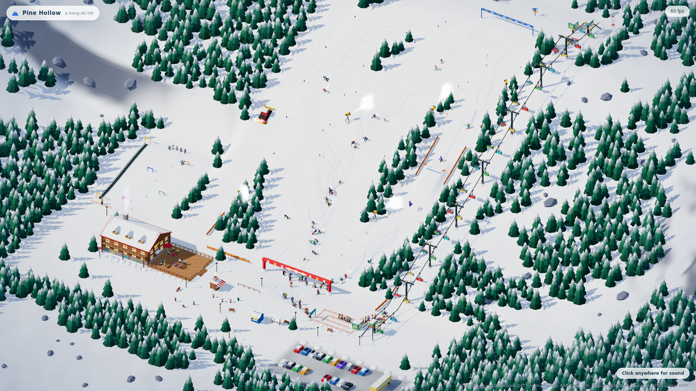
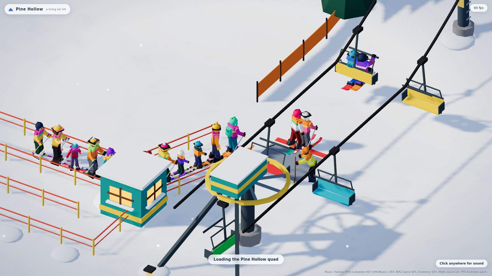

# Pine Hollow

A living ski hill that runs in the browser. About 125 little people ski down three runs, skate across the
base, queue, ride the quad chair back up and do it again, while a ski school snakes down the bunny slope,
kids build snowmen, the lodge deck fills up, a snowcat grooms and the ski patrol tows a sled to falls.
A camera director picks moments at random, gets there just before they happen, and pulls back again.

**Watch it: https://loktar00.github.io/pine-hollow/**

Nothing to play yet: it is a self-running scene, built so that a game can grow out of it.
Wheel and drag move the camera (the director takes it back after a few seconds), `M` mutes, `F` hides the
fps counter, `D` toggles the director. Add `?seed=123` for a different day or `?only=wipeout` to make the
director wait for one kind of story.

## How it works

- A deterministic simulation on a fixed 60 Hz step, driven by one seeded random generator. No DOM in it,
  so it runs in node for tests.
- Every person is one object for the whole session and only ever moves by velocity: skiing, queueing,
  riding and falling are states of the same person. A test fails if anyone teleports.
- three.js with an orthographic camera. Everything static is merged into a few meshes; everything that
  moves is drawn from two instanced meshes, so a frame is about ten draw calls.
- People are posed in code from their state and the distance they have travelled.

`ARCHITECTURE.md` has the module map and notes on adding player control, building or an economy.

## Build and run

    python build.py                 # src/*.js + three.js -> dist/index.html (sounds are read from audio/ next to it)
    python tools/scramble_audio.py dist/index.html audio index.html   # embeds the sounds into the page, scrambled
    python -m http.server 8000      # then open http://localhost:8000/

The scrambled page carries its own sounds, so it also runs from a plain file. Without that step the page needs a
folder of sound files called `audio/` next to it.

    node test/sim.test.js 12        # behaviour tests: 12 simulated minutes

## Credits

Code and models by [@loktar00](https://github.com/loktar00). Rendering uses [three.js](https://threejs.org) (MIT).
